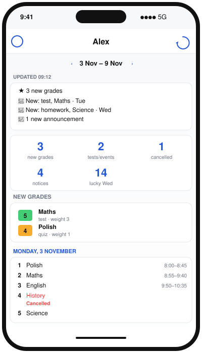
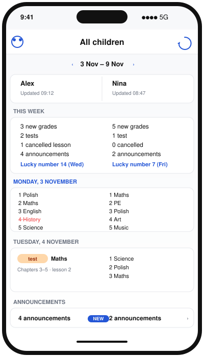

# Librus Tygodniowy

**Tydzień Twojego dziecka w Librusie na jednym ekranie.** Co jest w planie, jakie nowe oceny, który sprawdzian, co odwołane, jakie ogłoszenia — bez klikania w cztery zakładki Synergii.

Kilka minut i aplikacja jest gotowa. Działa tylko na Twoim telefonie — żadnego pośredniego serwera, żadnej analityki, żadnego konta w aplikacji do założenia.

<table>
  <tr>
    <td align="center"></td>
    <td align="center"></td>
  </tr>
  <tr>
    <td align="center"><sub>Tydzień jednego dziecka</sub></td>
    <td align="center"><sub>Rodzeństwo obok siebie</sub></td>
  </tr>
</table>

## Dlaczego warto

- **Wszystko w jednym widoku.** Oceny z tego tygodnia, lekcje ze zmianami, sprawdziany, zadania domowe, szczęśliwy numerek i ogłoszenia — bez przeklikiwania.
- **Rodzeństwo obok siebie.** Widok kolumnowy pokazuje tydzień każdego dziecka na jednym ekranie. Jedno spojrzenie i wiesz, kto ma dziś co.
- **„Co się zmieniło”.** Po odświeżeniu widzisz, co przybyło od ostatniej aktualizacji — nowe oceny, nowe sprawdziany, zmiany w planie. Oznaczone znacznikiem **NOWE**.
- **Działa offline.** Ostatnio pobrane dane masz od razu po otwarciu aplikacji. Internet potrzebny tylko, kiedy chcesz świeże.
- **Hasła tylko u Ciebie.** Trzymane w Pęku kluczy iOS (albo Android Keystore) — nigdzie indziej nie wychodzą.
- **Twoja prywatność.** Nie ma konta w aplikacji, nie ma analityki, nie ma reklam. Tylko Ty i Librus.
- **Polski albo angielski.** Przełącznik w Ustawieniach, osobno od języka telefonu.

## W pięciu krokach — iOS

Potrzebujesz Maca z Xcode i konta w Apple Developer Program.

### 1. Sklonuj i wygeneruj projekt

```bash
git clone https://github.com/mbialkowski/librus-weekly.git
cd librus-weekly/ios
brew install xcodegen
xcodegen generate
open LibrusSummary.xcodeproj
```

### 2. Uzupełnij podpis

W `ios/Config/Signing.xcconfig` wpisz dwie rzeczy:
- `DEVELOPMENT_TEAM` — dziesięcioznakowy identyfikator zespołu z developer.apple.com → Account → Membership details (albo Xcode → Settings → Accounts → Twój Apple ID).
- `BUNDLE_ID` — coś unikalnego, np. `com.twojanazwa.librusweekly`.

W Xcode zaloguj się na swoje Apple ID (**Settings → Accounts → +**).

### 3. Uruchom na telefonie

Podłącz iPhone, wybierz go w Xcode jako cel i naciśnij **Run**. Xcode pobierze zależności i zainstaluje aplikację. Na telefonie zaufaj swojemu profilowi deweloperskiemu (Ustawienia → Ogólne → VPN i Zarządzanie urządzeniem).

### 4. Zaloguj dziecko

Otwórz aplikację, wpisz login Synergia (`1234567u`) i hasło rodzica. **Dodaj dziecko** w menu u góry po lewej dodaje kolejne.

### 5. (Opcjonalnie) TestFlight

Chcesz rozdać rodzinie i nie chce Ci się podłączać każdego telefonu? Zrób to raz przez TestFlight:

1. W [App Store Connect](https://appstoreconnect.apple.com) **Apps → + → New App** z tym samym Bundle ID.
2. W terminalu:
   ```bash
   cd ios && ./scripts/upload-testflight.sh
   ```
3. W App Store Connect pod **TestFlight → Internal Testing** utwórz grupę i dodaj testerów.

Buildy TestFlight wygasają po 90 dniach — wyślij nowy przed terminem. Zostań przy testerach wewnętrznych: Librus nie lubi aplikacji trzecich w publicznych sklepach.

## W trzech krokach — Android

### 1. Sklonuj

```bash
git clone https://github.com/mbialkowski/librus-weekly.git
cd librus-weekly/android
```

### 2. Zbuduj

Najprościej w **Android Studio**: otwórz folder `android/`, poczekaj na synchronizację, naciśnij **Run**.

Z terminala:
```bash
./gradlew assembleDebug
```
APK trafia do `app/build/outputs/apk/debug/app-debug.apk`.

### 3. Zainstaluj i zaloguj dziecko

```bash
adb install -r app/build/outputs/apk/debug/app-debug.apk
```
Otwórz aplikację, wpisz login Synergia i hasło rodzica. **Dodaj dziecko** w menu u góry dodaje kolejne.

Szczegóły (co dokładnie działa, co jeszcze nie): [`android/README.md`](android/README.md).

## Co pobiera z Librusa

- Obsługiwany jest tylko login **Synergia** (np. `1234567u`), nie e-mail Konta Librus.
- Pobiera: oceny, plan lekcji (ze zmianami i odwołaniami), wydarzenia z kalendarza, zadania domowe, ogłoszenia, szczęśliwy numerek.
- Ogłoszenia starsze niż 30 dni są ukryte z widoku tygodnia.
- Sesje żyją tak długo, jak pozwala Librus; kiedy wygasają, aplikacja loguje się ponownie zapisanym hasłem.

## Struktura projektu

```
ios/
  LibrusSummary/           aplikacja SwiftUI
    App/                   punkt wejścia
    State/                 model, Pęk kluczy, ustawienia, logika tygodnia
    Views/                 logowanie, tydzień, obok siebie, ustawienia
    Resources/             assety, en.lproj + pl.lproj Localizable.strings
  Packages/LibrusKit/      klient API Librus (pakiet Swift)
  Config/Signing.xcconfig  Twój Team ID i Bundle ID
  scripts/                 pomocnik do TestFlight
  project.yml              wejście dla XcodeGen

android/
  app/src/main/java/com/example/librusweekly/
    librus/                klient API Librus w Kotlinie
    state/                 ViewModel, pamięć kont, cache, logika tygodnia
    ui/                    ekrany Compose
  app/src/main/res/        strings (en + pl), ikona, motyw

docs/screenshots/          makiety z tego README
```

## Podziękowania i licencja

Pakiet Swift `LibrusKit` (`ios/Packages/LibrusKit/`) został przeportowany przez [wadamczewski/szkolny.eu-iOS](https://github.com/wadamczewski/szkolny.eu-iOS) z androidowego projektu [Szkolny.eu](https://github.com/szkolny-eu/szkolny-android), oba na GPL-3.0. Klient w Kotlinie bazuje na tym samym kodzie. Dziękuję autorom — bez ich pracy tej aplikacji by nie było.

Repozytorium jest na licencji **GPL-3.0** (zobacz [`LICENSE`](LICENSE)). Możesz forkować, zmieniać, budować dla siebie i rozdawać — każda pochodna, którą rozpowszechniasz, też musi zostać na GPL-3.0 i zachować powyższe podziękowania.

Aplikacja nieoficjalna, niezwiązana z Librus sp. z o.o.

## Co nowego

### 2026-11-04 — Plan zajęć
- Aplikacja przemianowana na **Plan zajęć**, nowa ikona (kalendarz + ikonki uczniów).
- **Przyklejony nagłówek z imieniem dziecka** nad listą — zostaje widoczny przy przewijaniu. Imię wyśrodkowane, bez znacznika „Zaktualizowano".
- **Zakres godzin dnia** nad listą lekcji w kolumnie („7:45–13:05") — od razu widać, do kiedy dziecko jest w szkole.
- **Szczegóły zastępstw** w widoku obok siebie: nota („Zastępstwo za …") plus (nauczyciel · sala) pod spodem.
- **Ogłoszenia jako akordeon** w kolumnie, rozwijany w miejscu. Ogłoszenia, które mają wszystkie dzieci (ten sam temat + data), lądują w osobnym akordeonie „Shared: N" na dole sekcji — raz zamiast N razy.
- **Koniec z obcinaniem tekstu** — opisy sprawdzianów, treść błędów i ostrzeżeń oraz długie tytuły ogłoszeń zawijają się w pełni, do lewej; da się zaznaczyć i skopiować.
- **Imiona zamiast „imię + nazwisko"** w tytule i menu.

### 2026-11-04 (wcześniej)
- Pobieranie **zebrań / wywiadówek** z osobnego endpointu Librusa (`/ParentTeacherConferences`) — pokazują się w planie na swój dzień.
- **Android**: port klienta Librusa do Kotlina, widok tygodnia i „obok siebie", trwały cache, śledzenie zmian, przełącznik języka Systemowy / English / Polski.
- README w języku polskim, makiety po polsku.
